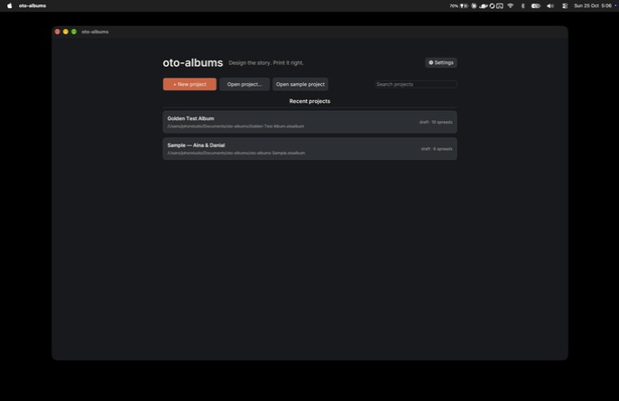
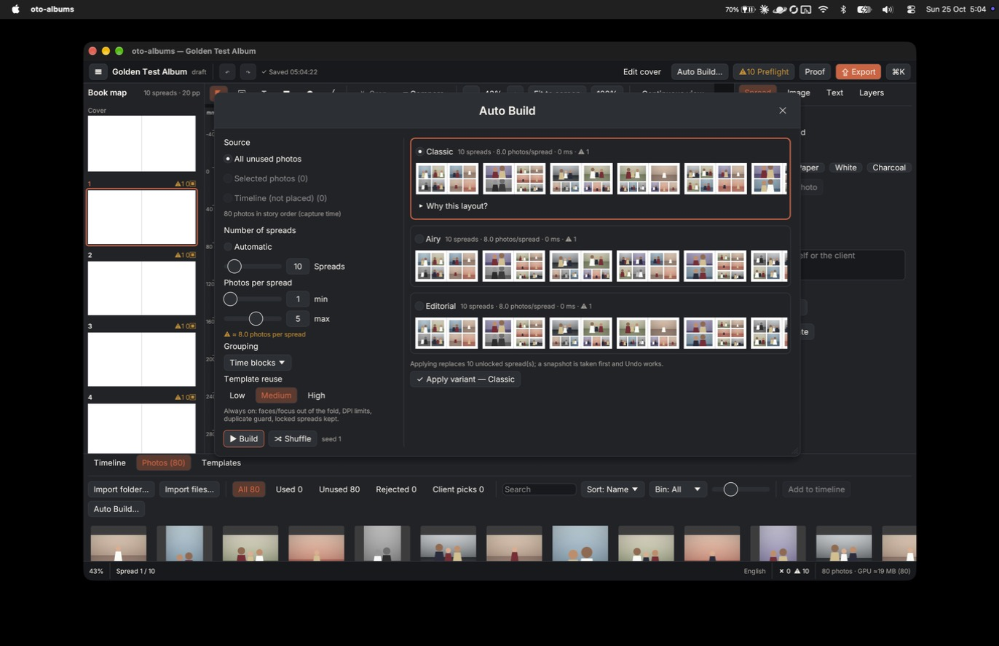
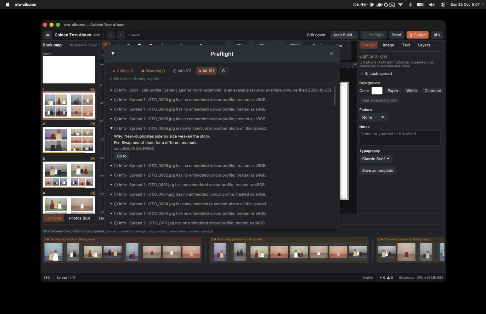
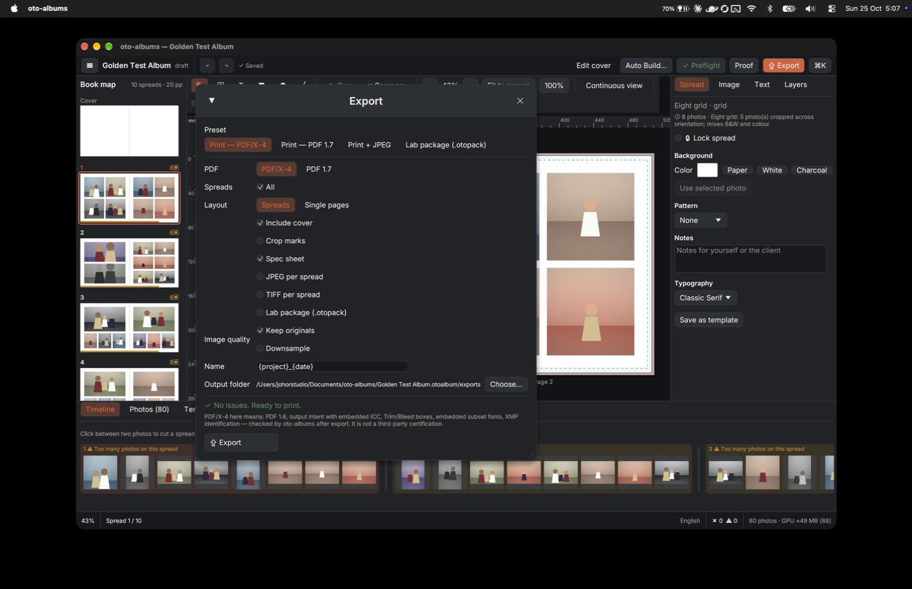
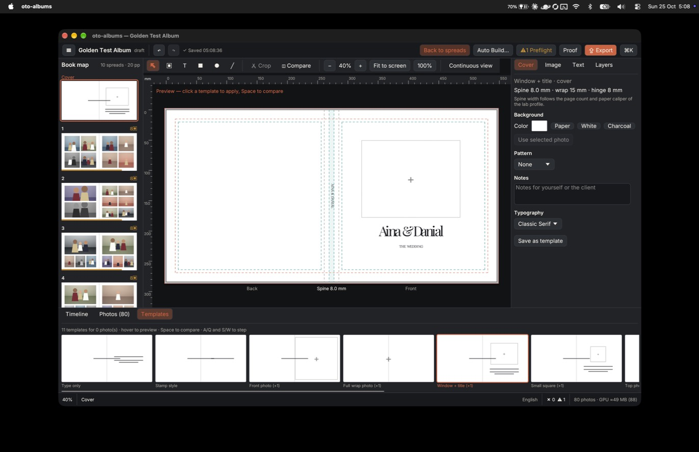
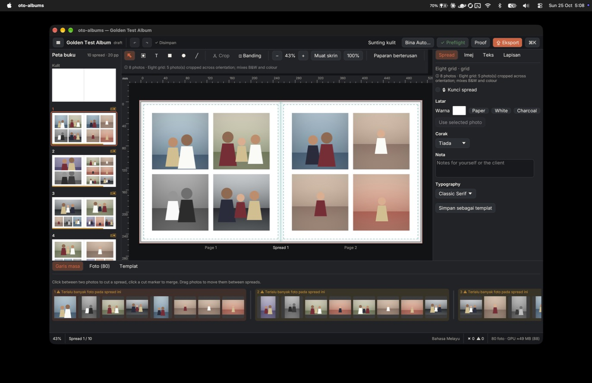

# oto-albums

Offline desktop app for designing wedding and portrait albums, from a folder of photos to a print-ready PDF.
It is native Rust (egui/eframe on wgpu). There is no web view, no login, no cloud and no telemetry.


| | |
|---|---|
|  |  |
|  |  |
|  |  |

These are real screenshots of the built app (macOS, Apple Silicon), taken on 25 Oct 2026.

## What it does

- **Projects**: each album is one `.otoalbum` package (SQLite + `manifest.json` + `media/links.json` + cache/snapshots/exports/logs). Originals are linked, never copied or modified. See [docs/project-format.md](docs/project-format.md).
- **Import**: folders or files (JPEG, PNG, TIFF, WebP, PSD flattened composite; HEIC/RAW not supported). Import reads EXIF, hashes with BLAKE3 (duplicates are flagged, never removed), computes a dHash for near-duplicates, and builds 256/1024/2048 px previews in the background.
- **Timeline and story**: photos in capture order with cut markers that define spreads. You can rate, reject, pick and bin. Nothing is ever auto-deleted or auto-rejected.
- **Templates**: 76 original built-in templates (65 spread and 11 cover) in 9 families, saved as plain TOML. Your own templates can be saved from any spread.
- **Clean templates (new, engine only)**: a generator builds a "clean" set for the real album size. Frames are exactly 3:2, 2:3 or square, there is one uniform gap, top and bottom margins are equal, and you get hero-across-the-fold, matted, bleed and mirrored variants (about 50 base layouts per size). The rules are in [docs/TEMPLATE-STYLE.md](docs/TEMPLATE-STYLE.md) and a contact sheet is in [docs/clean-templates-sheet.png](docs/clean-templates-sheet.png). They are not yet shown in the app's Templates strip.
- **Auto Build**: a deterministic solver builds three variants (Classic, Airy, Editorial) from the same photos and seed. Every spread explains its choice ("Why this layout?"). Locked spreads are kept. Applying takes a snapshot first, and Undo restores the previous layout.
- **Editor**:
  - frames, crop (pan, zoom, rotate, focus point), text with bundled OFL fonts, shapes, patterns and layers;
  - snapping, rulers, bleed/trim/safe/gutter guides, compare view and continuous view;
  - undo/redo for 100 steps and a ⌘K command palette. See [docs/keyboard-shortcuts.md](docs/keyboard-shortcuts.md).
- **Cover editor (2D)**: back, spine and front with wrap and hinge. Spine width follows page count × paper caliper from the lab profile.
- **Preflight**: about 22 checks, each with *why*, *where*, *fix* and *Go to*. Critical issues block export. An override needs a reason, which is written to the export audit. See [docs/pdf-preflight-checklist.md](docs/pdf-preflight-checklist.md).
- **Export**:
  - PDF/X-4-structured PDF (1.6, OutputIntent + embedded ICC, TrimBox/BleedBox, subset fonts, XMP) or PDF 1.7;
  - spreads or single pages, cover PDF and a spec sheet PDF + JSON;
  - SHA-256 checksums, JPEG/TIFF per spread and an `.otopack` lab bundle.
  - oto-albums checks its own output after export. **It has not been certified by a third-party PDF/X validator** (see STATUS.md).
- **Proof**: a local proof PDF with numbered photos, a comment sheet and a watermark. The web proof is an API contract only ([docs/web-proof-api.md](docs/web-proof-api.md)).
- **Safety net**:
  - autosave about 2 s after an edit, from a background DB thread;
  - automatic snapshots (the last 10 are kept) and manual snapshots;
  - crash detection on next open with recovery from the last autosave;
  - an integrity check on open.
- **Accessibility and language**: English UI with a Bahasa Melayu switch (click the language name in the status bar, or ⌘K → "Bahasa"). There is a high-contrast theme, UI scale, reduced motion, and AccessKit for screen readers.

## Install (macOS, Apple Silicon)

Download `oto-albums-0.1.0-macos-arm64.zip` from the [latest release](https://github.com/RafieRosliputra/oto-albums/releases/latest), unzip it, move `oto-albums.app` to `/Applications` and open it.

It is ad-hoc signed and not notarised. The first time, right-click → **Open** (or System Settings → Privacy & Security → *Open Anyway*).

Click **Open sample project** on the start screen to explore a ready-made album built from synthetic, non-copyrighted photos.

## Build from source

Requirements: Rust 1.80+ (built with 1.99) (`rustup`), Xcode command-line tools on macOS. Python 3 is only needed for the asset/validation helper scripts.

```sh
cd app
cargo run --release -p oto-app            # run the app
cargo test --workspace --release          # unit + integration tests
cargo clippy --workspace --all-targets -- -D warnings
cargo fmt --all --check
sh tools/bundle_macos.sh                  # build dist/oto-albums.app + zip (INSTALL=1 also copies to ~/Applications)
```

**Windows**: the code is cross-platform. Platform specifics sit behind the `oto-platform` crate, which includes file association via HKCU. Windows has **not been built or tested** in this release (Mac-first by request). To try it, run `cargo build --release -p oto-app` on Windows 10/11 x64 with the MSVC toolchain. See [docs/packaging.md](docs/packaging.md).

## Command line

`oto-cli` uses the same engine as the app:

```
oto-cli preflight <project.otoalbum>
oto-cli export <project.otoalbum> [--out DIR] [--ack] [--jpeg] [--single] [--pdf17] [--pack]
oto-cli proof <project.otoalbum> [--out DIR]
oto-cli validate <file.pdf> --pages N [--x4]
oto-cli sample <DIR>          # the sample project
oto-cli fixtures <DIR>        # synthetic test images
oto-cli synth <DIR> [N] [PX]  # N synthetic photos for import benchmarks
oto-cli templates <DIR>       # export built-in templates as TOML
oto-cli bench [--photos N] [--spreads N] [--import DIR]
oto-cli golden <DIR>          # scripted end-to-end golden path
```

## Repository layout

```
crates/   oto-core  oto-media  oto-store  oto-render  oto-print  oto-proof  oto-ui  oto-platform  oto-app  oto-cli
assets/   fonts (OFL) + sRGB ICC
labs/     example lab profiles (generic, NOT real labs)
templates/ built-in templates exported as TOML (generated by `oto-cli templates`)
tests/fixtures/ synthetic images (generated by `oto-cli fixtures`)
tools/    bundling, icon, asset and PDF-validation scripts
docs/     formats, checklists, shortcuts, API contract, screenshots
```

More detail is in ARCHITECTURE.md, DECISIONS.md, STATUS.md, PERF.md and CHANGELOG.md.

## Licences

- App code: proprietary (Johor Studio).
- Bundled fonts: SIL Open Font License, with the licence files next to each font in `assets/fonts`.
- The ICC profile is a generated sRGB v2 profile.
- No third-party UI assets, templates or icons from other album software are used.
